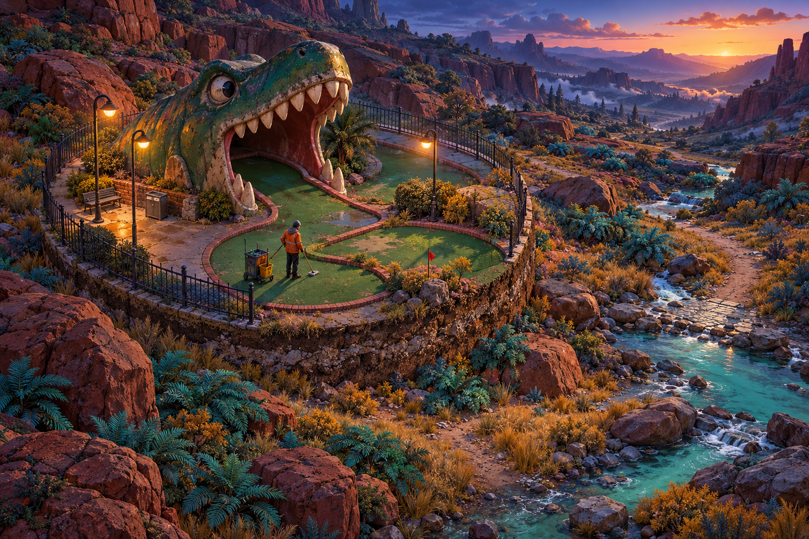

# Oozing

**Ночью ты убирал парк. Утром за пастью пластикового динозавра оказался другой мир.**

Oozing — проект самостоятельной изометрической 3D-игры о просачивании круглых фрагментов нашей реальности в чужую. Каждый фрагмент приносит людей, вещи, ресурсы, привычки и след катастрофы. На границе переноса всё разделяется; после него действуют материальные правила.

Это дизайн-библия v0.2, обновлённая 2 ноября 2026 года: цельный вариант мира, сценария и систем для совместного обсуждения. Сейчас в проекте **документы, концепт, технический образец генерации рельефа и первая играбельная сцена на Godot 4.7**. Зафиксированные требования автора отделены от предлагаемых решений.

## Начать здесь

0. [Первая сцена: прогулка по Кроме](game/README.md) — как запустить на Mac и что посмотреть.
1. [Замысел и отличительные черты](docs/00-vision.md) — во что играем и ради каких сцен.
2. [История миров](docs/01-world-history.md) — предлагаемая Крома, земные фрагменты и тайна просачивания.
3. [Сюжет и первые 30–45 минут](docs/03-story-and-scenario.md) — как идея становится действием игрока.
4. [3D-ассеты и производство](docs/14-asset-production.md) — откуда брать модели, что создавать и как проверять качество.
5. [Решения и вопросы](docs/17-decisions-and-questions.md) — что уже согласовано и что выбираем дальше.

## Документы по аспектам

| Файл | Содержание |
| --- | --- |
| [00 — Замысел](docs/00-vision.md) | Обещание игроку, опоры дизайна, ритм, границы первой версии |
| [01 — История миров](docs/01-world-history.md) | Земля, Крома, прошлое явления, человеческие организации и центральный конфликт |
| [02 — Правила мира](docs/02-world-rules.md) | Геометрия переноса, срезы, материя, время, люди, неизменяемые правила |
| [03 — Сюжет и сценарий](docs/03-story-and-scenario.md) | Акты, персонажи, пролог, выборы, последствия, развязки |
| [04 — Игровой цикл и развитие](docs/04-gameplay-and-progression.md) | Исследование, выживание, навыки уборщика, инвентарь, поражение |
| [05 — Люди и фракции](docs/05-people-and-factions.md) | Генерация биографий, 90% враждебности, отношения, одежда, разговоры |
| [06 — Бой и оружие](docs/06-combat-and-weapons.md) | Материальные столкновения, укрытия, арсенал, травмы и альтернативы бою |
| [07 — Добыча и экономика](docs/07-loot-crafting-and-economy.md) | Происхождение предметов, ремесло, торговля, дефицит, ресурсные потоки |
| [08 — Лагеря, спутники, поселения](docs/08-camps-companions-and-settlements.md) | Привалы, постоянный дом, дальние экспедиции, люди и логистика |
| [09 — Генерация мира](docs/09-world-generation.md) | Сектора 400 × 400 м, реки, высоты, seed, загрузка, сохранения и проверки швов |
| [10 — Физика и разрушение](docs/10-physics-and-destruction.md) | Коллизии, вода, опоры, обломки, срезы и постоянные изменения |
| [11 — Местность и экология](docs/11-environments-and-ecology.md) | Биомы, флора, рельеф, природные условия; отложенные фауна и монстры |
| [12 — Локации и данжи](docs/12-dungeons-and-locations.md) | Лаборатория, склад, магазин, ферма, клуб, маршруты и композиция |
| [13 — Визуальный стиль](docs/13-art-direction.md) | Цвет, материалы, силуэты, люди, свет, читаемость |
| [14 — Производство ассетов](docs/14-asset-production.md) | Источники 3D, процедурные объекты, одежда, оружие, срезы, критерии качества |
| [15 — Камера, UI и звук](docs/15-camera-controls-ui-audio.md) | Вид 45°, управление, интерфейс, аудио и доступность |
| [16 — Технология и этапы](docs/16-technology-and-roadmap.md) | Варианты движка, архитектура, первое демо, риски и критерии перехода |
| [17 — Решения и вопросы](docs/17-decisions-and-questions.md) | Подтверждённое автором, рабочие допущения, следующие развилки |
| [18 — Источники](docs/18-sources.md) | Официальные ссылки по движкам, моделям и лицензиям |
| [19 — Три гипотезы](docs/19-beliefs-and-evidence.md) | Попадание, обмен, копирование: аргументы, вера, семьи и неоднозначные улики |
| [20 — Причины конфликтов](docs/20-conflicts-and-encounters.md) | Мотивация врагов, проход и частные зоны, эскалация, отход и примеры встреч |
| [21 — Хронология и массовые исчезновения](docs/21-chronology-and-mass-disappearances.md) | Земной архив, давность поселений, редкие крупные случаи и пределы свидетельств |
| [22 — Происхождение и эпохи](docs/22-transfer-origins-and-eras.md) | Люди разных времён и стран, 12 семейств переносимых мест, природные и морские фрагменты |

## Проверяемый образец генерации

[Описание и запуск](prototypes/terrain/README.md): один водосбор 3,2 × 3,2 км, 64 сектора по 400 м, рельеф, сток, реки, озёра и распределение пяти демонстрационных сред. Генератор выдаёт JSON и диагностические карты; это ещё не 3D-сцена и не игровой кадр. Архитектура большого мира и пещер описана отдельно в документе 09.

## Визуальное направление

Растровый концепт задаёт настроение и палитру. Панорамный кадр не является скриншотом или точной моделью игровой камеры. [Исходный промпт и заметки](assets/concepts/README.md).

## Что согласовано сейчас

Приключение с выживанием без бытовой рутины. Яркая тревожная красота, человеческая жестокость и чёрный юмор. Странствия и привалы, постоянное поселение и передвижной лагерь со спутниками входят в общее видение и реализуются последовательно.

Крома имеет собственные горы, леса, степи, высокотравье, озёра, реки, пещеры, ущелья, лощины и опушки. Земные фрагменты приходят из разных стран и эпох; дата источника и время жизни в Кроме учитываются отдельно. Перенос может принести толпу людей, часть сооружения или необитаемую природу. Морские фрагменты содержат конечный объём воды, без вечного притока из Земли.

У попаданцев есть три конкурирующие гипотезы: попадание, двусторонний обмен и копирование. Их убеждения влияют на решения, но ни одна версия не объявлена истиной. Люди живут в общинах с понятным снабжением; враждебность к новичку переходит в насилие через конкретный мотив и событие. Обычный проход мимо охраны не запускает автоматическую атаку.

Прототип должен доказать ценность одного маршрута с тремя кругами, физическими препятствиями, конфликтом и сохранением последствий.

После уточнений автора закреплены **радиус 5–40 м** и **первая версия для macOS**. Механизм просачивания пока остаётся тайной; взаимный обмен не считается установленным фактом.

**Решения 2 ноября 2026 года** (подробно — в [журнале решений](docs/17-decisions-and-questions.md); часть документов ещё не приведена к ним):

- Перенос — **вертикальный цилиндр, «объём»**, на всю высоту сооружения: все этажи в радиусе переносятся, и на них можно забраться.
- Исходно враждебны **50%** случайных людей; почти все недоверчивы и предвзяты.
- В экшн входят **местная фауна** и **столкновения поселений за ресурсы** при наличии мотива.
- Игра и её название — **на русском**; название пока подбирается, `oozing` остаётся рабочим именем репозитория.
- Движок — **Godot 4.7**; машина разработки — MacBook Air M5, 16 ГБ.
- Референсы: «Тёмная Башня» Стивена Кинга, Fallout, «Пикник на обочине».
